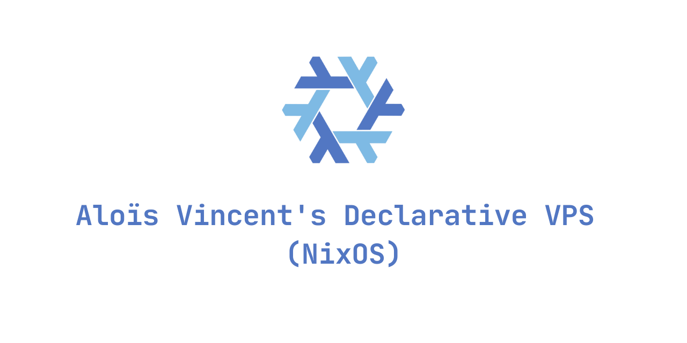
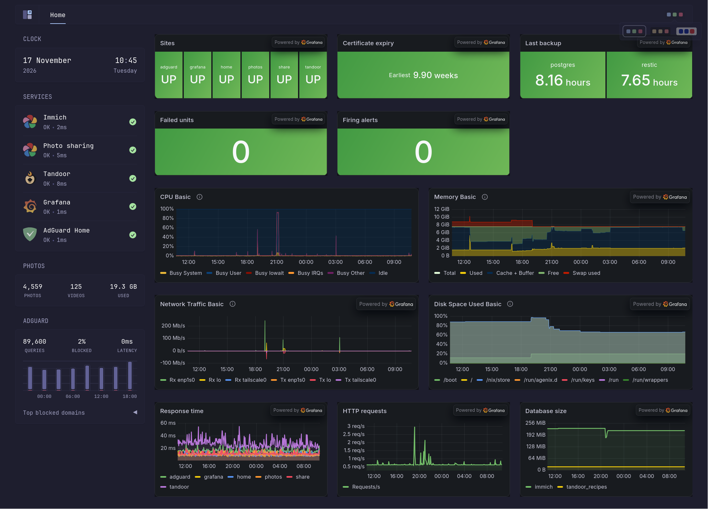

<p align="center">
  
</p>

<h1 align="center">Declarative NixOS VPS Configuration</h1>

<p align="center">
  <a href="https://nixos.org/">
    
  </a>
  <a href="https://github.com/AloisHasNeurons/vps-nixos-config/blob/master/LICENSE">
    
  </a>
  <a href="https://github.com/AloisHasNeurons/vps-nixos-config/actions">
    
  </a>
  <a href="https://github.com/AloisHasNeurons/vps-nixos-config/actions">
    
  </a>
</p>

<p align="center">
  A fully declarative, reproducible and tested server configuration, built with <b>NixOS</b>, <b>Terraform</b> and <b>GitHub Actions</b>. It runs my self-hosted services (photos, recipes, DNS filtering) on a Hetzner Cloud VPS, with monitoring, alerting and backups defined in the same repository.
  <br />
  <br />
  <a href="#why"><strong>Why</strong></a>
  ·
  <a href="#whats-running"><strong>Services</strong></a>
  ·
  <a href="#observability"><strong>Observability</strong></a>
  ·
  <a href="#security"><strong>Security</strong></a>
  ·
  <a href="#cicd--gitops"><strong>CI/CD</strong></a>
  ·
  <a href="#backups--disaster-recovery"><strong>Backups</strong></a>
  ·
  <a href="#usage"><strong>Usage</strong></a>
</p>

<p align="center">
  
</p>

---

## Why

Managing servers by hand ("ClickOps") or with imperative scripts leads to **configuration drift**: over time the server stops matching the documentation, updates become scary and rollbacks impossible. I wanted a system where:

1. **Destruction is trivial**: the server can be deleted and brought back, on another provider if needed, from what is in this repository plus the backups.
2. **Security is proved**: CI boots the real configuration in a VM and port-scans it before anything is deployed.
3. **Maintenance is automated**: dependency updates arrive as pull requests, are tested, and deploy themselves.

The setup is split in two layers:

- **Infrastructure (Terraform):** the Hetzner Cloud server (`cx33` in `fsn1`, with delete/rebuild protection and Hetzner backups), its SSH key, and the external uptime check on AWS. State is kept in HCP Terraform.
- **Configuration (NixOS):** everything on the machine, from disk layout ([disko](https://github.com/nix-community/disko)) to services, users and firewall. I describe the final state, and `nixos-rebuild` makes the system match it atomically. Every deploy is a new boot generation, so `nixos-rebuild switch --rollback` reverts the whole system.

---

## What's running

| Service | What it does | Exposure |
|---------|--------------|----------|
| [Immich](https://immich.app/) | Photo and video library, with machine learning (faces, smart search) | Tailnet only |
| [Immich Public Proxy](https://github.com/alangrainger/immich-public-proxy) | Serves Immich shared links without exposing Immich itself | **Public** (`share.photos.*`) |
| [Tandoor](https://tandoor.dev/) | Recipe manager | Tailnet only |
| [AdGuard Home](https://adguard.com/adguard-home/overview.html) | DNS filtering for the tailnet (OISD, HaGeZi lists), DNS-over-HTTPS upstreams, rewrites the domain to the Tailscale IP | Tailnet only |
| [Glance](https://github.com/glanceapp/glance) | Start page: service status, photo and DNS stats, Grafana panels | Tailnet only |
| Grafana · Prometheus · Alertmanager | Metrics, dashboards and alerts | Tailnet only |
| Nginx | Reverse proxy with a wildcard Let's Encrypt certificate (DNS-01 via OVH) | Ports 80/443 |
| PostgreSQL | Databases for Immich and Tandoor | Loopback |

Every service listens on `127.0.0.1` and is reached through Nginx. Apart from the photo-sharing proxy, every virtual host only accepts clients from the Tailscale range (`100.64.0.0/10`).

**Kept but not deployed:**
- A Fabric **Minecraft** server ([nix-minecraft](https://github.com/Infinidoge/nix-minecraft)), behind `my.minecraft.enable`. CI still evaluates it (`minecraft-eval` check) so it doesn't rot.
- A **media suite** (Jellyfin, Sonarr, Radarr, Prowlarr, Jellyseerr, seedbox over SSHFS) in `modules/media/`, not imported for now.

---

## Observability

The screenshot above is the [Glance](https://github.com/glanceapp/glance) start page at `home.<domain>`. The left column comes from Glance itself (clock, service monitor, Immich stats, AdGuard stats). The rest are Grafana panels embedded as iframes:

- **Status row** (custom `VPS Services` dashboard, written in Nix in [`modules/monitoring/dashboards/vps-services.nix`](modules/monitoring/dashboards/vps-services.nix)): HTTPS probe result per site, earliest certificate expiry, age of the last Postgres and restic backups, failed systemd units, firing alerts.
- **System row** ([Node Exporter Full](https://grafana.com/grafana/dashboards/1860), pinned by hash): CPU, memory, network traffic, disk space.
- **Services row** (`VPS Services` again): response time per site, Nginx requests per second, database sizes.

Grafana dashboards and datasources are provisioned from git, so edits made in the UI can't be saved.

### Metrics

Prometheus (15 s scrape, 30 days or 5 GB of retention) scrapes:

- `node_exporter`, with the `systemd` and `processes` collectors and a textfile directory where the backup jobs record their last success;
- the `blackbox` exporter, which probes every site over HTTPS as a tailnet client sees it (so a bad or missing certificate fails the probe) and checks that AdGuard still rewrites the domain to the Tailscale IP;
- the `nginx` and `postgres` exporters, plus Prometheus, Alertmanager and Grafana themselves.

### Alerts

Everything ends up in Telegram, through three independent paths:

| Path | Catches |
|------|---------|
| **Prometheus → Alertmanager** | Scrape target down, site failing its probe, certificate expiring within 21 days, DNS rewrite broken, disk over 85 % or filling up within 24 h, memory under 10 %, failed systemd unit, backup older than 26 h or never recorded |
| **`notify-failure@` systemd unit** | Any hooked service that fails (Nginx, AdGuard, Immich, Prometheus, Alertmanager, backups, ACME renewals...). The message includes the last 5 log lines. It still works when Alertmanager itself is down. |
| **AWS Lambda uptime check** | The whole server being unreachable, which the two paths above can't report |

### External uptime check

An agent running on the VPS goes silent when the VPS does, so the last path runs outside it. A Go [AWS Lambda](terraform/src/aws_health_check/main.go), triggered every minute by EventBridge, requests the server over HTTP. It keeps the last state (`UP`/`DOWN`) in SSM Parameter Store and only sends a Telegram message on a transition, including the exact failure (e.g. `connect: connection refused` or `502 Bad Gateway`).

An Azure Functions version of the same check is still in the repository ([`terraform/monitoring_azure.tf`](terraform/monitoring_azure.tf), [`src/azure_health_check`](terraform/src/azure_health_check)) but commented out.

---

## Security

### Network exposure

- **Firewall:** only TCP 22, 80 and 443 are open publicly, plus Tailscale's UDP port. `tailscale0` is a trusted interface.
- **Tailnet-only services:** admin interfaces and personal services are only reachable over [Tailscale](https://tailscale.com/). AdGuard serves the tailnet's DNS and rewrites `*.<domain>` to the server's Tailscale IP, so the same hostnames and certificate work everywhere.
- **Public surface:** only the Immich Public Proxy, which can't reach anything but Immich over loopback (`RestrictNetworkInterfaces=lo`).

### Host hardening

- **SSH:** keys only, no root login, `AllowUsers` limited to two accounts, short grace time and max 3 auth tries, no agent or TCP forwarding. **Fail2ban** bans repeat offenders, with ban time increasing up to a week.
- **Users:** `mutableUsers = false`, root password disabled, sudo requires a password (except for the CI `deploy` user).
- **Kernel:** latest kernel, AppArmor, sysctl hardening (`kptr_restrict`, `dmesg_restrict`, no ICMP redirects, SYN cookies...).
- **Nginx:** HSTS with preload, `nosniff`, a Content Security Policy.
- **Secrets:** encrypted with [agenix](https://github.com/ryantm/agenix) and committed to git, decrypted at boot with the server's SSH host key. Gitleaks scans every push and pull request.

### The "default deny" port scanner

[`tests/security.nix`](tests/security.nix) is a NixOS integration test that runs in CI before anything is merged or deployed:

1. It boots a VM with the production configuration.
2. A second VM runs `nmap` against it.
3. Any open port other than 22, 80 and 443 **fails the pipeline**. It also checks explicitly that the photo-sharing proxy's port, which is outside nmap's top 1000, stays unreachable.

> **Result:** an internal service (Grafana, AdGuard...) can't be exposed to the internet by mistake. The bad change is blocked before it leaves git.

---

## CI/CD & GitOps

### Pull requests

| Workflow | Does |
|----------|------|
| **CI - Nix** | `nix fmt --check` (alejandra), `deadnix`, flake evaluation, then one runner per check: the `security` port scan, the `services` test (every unit starts, listens on its port, answers on its virtual host, SSH settings are enforced, DNS rewrites behave, exporters report) and `minecraft-eval`. Builds are cached in Cachix. |
| **CI - Terraform** | Builds the Lambda, then `terraform fmt -check` and `terraform validate`. |
| **CI - Security** | Gitleaks over the whole history. |
| **Flake lock diff** | On `flake.lock` changes, builds the old and new systems and posts a comment listing the input and package version changes. |

### Renovate

[Renovate](https://docs.renovatebot.com/) runs daily from a GitHub Action. Flake inputs, GitHub Actions, Terraform providers and Go modules are kept up to date. `flake.lock` maintenance, minor/patch updates and security fixes are **merged automatically** once CI passes. Major updates wait for review.

### Deployment

Every push to `master` (except docs-only changes) runs [`deploy.yml`](.github/workflows/deploy.yml):

1. Run both CI workflows again.
2. `terraform apply`, only if `terraform/` changed.
3. Copy the repository to the server over SSH (host key pinned from `secrets/vps-host-key.pub`) and run `nixos-rebuild switch`. If the build fails, the running system is left untouched.
4. Smoke tests: Tailscale is up, conntrack doesn't drop packets, AdGuard resolves upstream, then [`health-check.sh`](.github/scripts/health-check.sh) checks the services.
5. If the kernel changed, reboot and run the health checks again. A server that doesn't come back turns the deploy red.

A manual **Server Reboot** workflow does the same reboot and checks on demand.

---

## Backups & Disaster Recovery

The configuration lives in git, so the only thing that really needs backing up is **state**: photos, databases and service data under `/var/lib`.

| Layer | What | When | Retention |
|-------|------|------|-----------|
| **Postgres dumps** | `pg_dumpall` of every database (`immich`, `tandoor_recipes`) to `/var/backup/postgresql/all.sql` | 02:30 | Overwritten nightly; kept in restic |
| **Restic -> Backblaze B2** | `/var/lib` + the Postgres dumps, encrypted and deduplicated | 03:00 | 7 daily, 4 weekly, 6 monthly |
| **Hetzner backups** | Full-disk snapshot of the server | Daily | 7 |
| **NixOS generations** | The system itself (not data) | Every deploy | See `nix.gc` |

Restic skips data that is useless, regenerable, or unsafe to copy while running: the swapfile, the live `/var/lib/postgresql` files (the dumps cover them), `/var/lib/containers`, Prometheus data, and Immich's `thumbs/` and `encoded-video/`. After each prune, restic also reads a random 5% of the repository to catch corruption. See [`modules/services/backup.nix`](modules/services/backup.nix).

> **Note:** `/etc` is **not** backed up. That includes the SSH host key that agenix uses to decrypt secrets. See [full server rebuild](#4-full-server-rebuild) for what that means.

### Runbook

All commands run on the VPS as root. NixOS installs a `restic-vps-data` wrapper that already loads the B2 credentials, repository and password, so it works like plain `restic`.

#### 1. Check that backups are healthy

```bash
systemctl list-timers 'restic-backups-*' 'postgresqlBackup*'
journalctl -u postgresqlBackup -u restic-backups-vps-data --since yesterday --no-pager | tail -40

sudo restic-vps-data snapshots                         # one snapshot per night
sudo restic-vps-data ls latest /var/backup/postgresql  # all.sql must be there
sudo restic-vps-data ls latest /var/lib                # top level only, no swapfile/postgresql
sudo restic-vps-data stats --mode raw-data             # real size stored in B2
sudo restic-vps-data check --read-data-subset=5%       # integrity check
```

If either unit fails, `OnFailure=notify-failure@%n.service` sends a Telegram alert. That includes a failed `restic check`, which runs inside the backup unit. To test the alert without breaking a backup:

```bash
systemctl show restic-backups-vps-data postgresqlBackup -p OnFailure   # hook is wired
sudo systemctl start notify-failure@restic-backups-vps-data.service    # sends a test alert
```

#### 2. Restore test (non-destructive)

Do this every few months, and after big Immich or Postgres upgrades. It doesn't touch the live services.

**Databases:** load the latest dump into a throwaway Postgres on port 5433. VectorChord must be preloaded, as it is on the live server:

```bash
sudo -u postgres initdb -D /tmp/pgtest
sudo -u postgres pg_ctl -D /tmp/pgtest -l /tmp/pgtest.log \
  -o "-p 5433 -k /tmp -c shared_preload_libraries=vchord.so" start

sudo restic-vps-data dump latest /var/backup/postgresql/all.sql \
  | sudo -u postgres psql -h /tmp -p 5433 -q postgres 2>&1 | grep -i error
```

These errors are expected and harmless:
- `role "postgres" already exists`: `initdb` already created it.
- `extension "vectors" is not available`, plus related errors about `vectors.*`: leftovers of pgvecto.rs, the extension Immich used before VectorChord. Its files are no longer installed.

Any other error (especially around `CREATE TABLE` or `COPY`) means the dump is damaged. Next, compare row counts with the live database. They should match, apart from uploads made since 03:00:

```bash
for port in 5432 5433; do
  sudo -u postgres psql -h /tmp -p $port -d immich -tAc \
    "select '$port', (select count(*) from asset), (select count(*) from person), (select count(*) from smart_search);"
done

sudo -u postgres pg_ctl -D /tmp/pgtest stop && sudo rm -rf /tmp/pgtest /tmp/pgtest.log
```

**Files:** restore a folder next to the live one and compare:

```bash
sudo restic-vps-data restore latest --target /root/restore-test --include /var/lib/immich/upload
sudo diff -r /root/restore-test/var/lib/immich/upload /var/lib/immich/upload && echo IDENTICAL
sudo rm -rf /root/restore-test
```

Restore a sub-folder instead if the disk doesn't have room for a second copy.

#### 3. Real restores

**A few files** (e.g. a deleted photo or a Tandoor image): restore to a side directory, then copy the files back with the right owner:

```bash
sudo restic-vps-data snapshots                         # pick a snapshot ID, or use `latest`
sudo restic-vps-data restore <id> --target /root/restore --include /var/lib/immich/library/<path>
sudo cp -a /root/restore/var/lib/immich/library/<path> /var/lib/immich/library/<path>
sudo chown -R immich:immich /var/lib/immich/library/<path>
```

**A database rollback on the live server.** This replaces the current data, so take a fresh dump first (`sudo systemctl start postgresqlBackup`, then copy `all.sql` somewhere safe):

```bash
sudo systemctl stop immich-server immich-machine-learning tandoor-recipes
sudo restic-vps-data dump <id> /var/backup/postgresql/all.sql > /root/restore.sql

sudo -u postgres psql -c 'DROP DATABASE immich WITH (FORCE);' -c 'DROP DATABASE tandoor_recipes WITH (FORCE);'
sudo -u postgres psql -q -f /root/restore.sql postgres 2>&1 | grep -i error   # "role ... already exists" is expected

sudo systemctl start immich-server immich-machine-learning tandoor-recipes
```

`pg_dumpall` recreates the databases itself, which is why they are dropped first. Loading it into existing databases would duplicate every row.

#### 4. Full server rebuild

There are two ways to bring the server back. Neither has been rehearsed end-to-end yet.

- **Fastest: a Hetzner backup.** In the Hetzner console, rebuild the server from its most recent backup image. The host key comes back too, so agenix works unchanged. Rebuild protection must be turned off temporarily in the console, since Terraform enables it. You lose whatever changed since that backup (up to 24 h).
- **From scratch: restic.** Use this if the Hetzner project or server is gone, or to move to another provider.
  1. Provision a new server (`terraform apply`) and install NixOS on it.
  2. The new server has a **new SSH host key**, so it can't decrypt the existing secrets. On the laptop, put its key in `secrets/secrets.nix` (`ssh-keyscan <ip>`), run `agenix -r` in `secrets/`, commit, and deploy. Until this is done, agenix-backed services (Grafana, Immich, Tandoor, restic itself) fail to start.
  3. Stop the services, then restore the state: `sudo restic-vps-data restore latest --target / --include /var/lib`.
  4. Restore the databases as in the rollback above, using `latest`.
  5. Make sure ownership survived. Restic restores numeric UIDs/GIDs, and a fresh install may have assigned different ones. Run `ls -ln /var/lib`, and `chown -R` where needed (for example `immich:immich /var/lib/immich`).
  6. Start the services, then in Immich run *Administration → Jobs → Generate Thumbnails* and *Transcode Videos* (those folders aren't backed up).

---

## Usage

Deployment is automatic on push to `master`. Locally:

```bash
# Run the checks: both VM tests and the Minecraft evaluation
nix flake check

# Run a single VM test
nix build -L .#checks.x86_64-linux.security

# Build and start a local VM of the server
# (forwards SSH to 12222, HTTP to 18080, HTTPS to 18443, AdGuard to 13000, Glance to 13001)
nix run .#vps-vm

# Format
nix fmt
```

### Terraform

Provisioning normally runs in CI. To run it by hand:

```bash
cp .env.example .env   # fill in TF_VAR_hcloud_token
source .env
cd terraform
nix develop ..#default --impure -c terraform init
nix develop ..#default --impure -c terraform apply
```

### Secrets

Secrets are declared in [`secrets/secrets.nix`](secrets/secrets.nix). To edit one, or re-encrypt all of them after a key change:

```bash
cd secrets
nix develop ..#default -c agenix -e restic-env.age
nix develop ..#default -c agenix -r
```

---

## Repository layout

```
.
├── flake.nix                 # Inputs, the `vps` system, checks, dev shell, local VM
├── configuration.nix         # Boot, users, SSH, firewall, fail2ban, agenix secrets
├── disk-config.nix           # Disk layout (disko)
├── modules/
│   ├── monitoring/           # Prometheus, Alertmanager, Grafana, alert rules, dashboards
│   ├── networking/           # Tailscale, static IPv6
│   ├── services/             # Immich, Tandoor, AdGuard, Glance, Nginx, backups, Minecraft
│   ├── system/               # Kernel hardening, shell
│   └── media/                # Media suite (not imported)
├── tests/                    # NixOS VM tests: security port scan, services
├── secrets/                  # agenix-encrypted secrets and public keys
├── terraform/                # Hetzner server, AWS uptime check (+ Go sources)
├── .github/                  # Workflows and their helper scripts
└── renovate.json
```

---

## 📄 License

This project is licensed under the MIT License - see the [LICENSE](LICENSE) file for details.

---
<p align="center">
  <em>Aloïs Vincent - Software Engineering Student</em>
</p>
